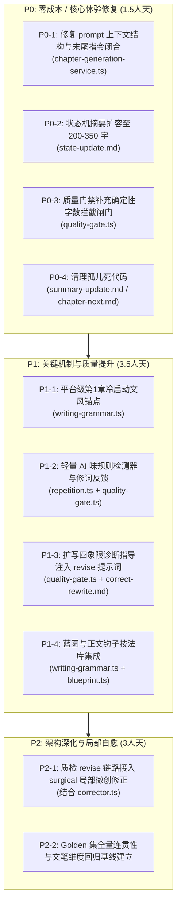

# 对《chinese-novelist-skill 借鉴分析》的独立架构评审与工程落地规划

> **评审基准**：[docs/research/2026-10-25-chinese-novelist-skill-analysis.md](file:///Users/reed_soul/code/novel-eval/docs/research/2026-10-25-chinese-novelist-skill-analysis.md)  
> **代码基线**：`packages/writer/src/`  
> **落盘文件**：[docs/research/agent-reviews/agy-review.md](file:///Users/reed_soul/code/novel-eval/docs/research/agent-reviews/agy-review.md)  
> **核心裁决**：原方案对开源项目的长处定位准确（方法论与 prompt 资产），但**脱离了 `packages/writer` 真实的生产代码结构**。方案中存在**对死代码的误认**、**策划态与执行态状态机的混淆**、以及**对历史死锁教训的遗忘**。本评审将 8 项建议重构为「3 项采纳、2 项修改后采纳、3 项坚决不采纳」，并补充 5 项被原方案遗漏的关键架构缺口。

---

## 一、方案核心论点逐项评审（采纳 / 不采纳 / 修改）

### 1. 动笔前上下文顺序（近因效应利用）
* **原方案观点**：P0，将最近章节原文放在 prompt 最末尾，蓝图/状态前置。
* **评审裁决**：**修改后采纳（Conditionally Adopt with Refinement）**
* **代码级依据**：
  * 真实生产链路在 [`packages/writer/src/services/chapter-generation-service.ts`](file:///Users/reed_soul/code/novel-eval/packages/writer/src/services/chapter-generation-service.ts#L122-L177) 的 `buildPrompts`，而非 `chapter-next.md`。
  * 当前代码顺序为：元数据/平台指令 (L138-149) → 前章状态看板 (L151-153) → 卷摘要 (L154-162) → 最近章节原文 (L163-171) → 质量审阅反馈 (L172-174)。
  * **原方案低估的风险**：
    1. **尾部裸奔风险**：若直接将 `recentChapters`（通常为最近 3 章，约 6000-8000 字）置于最尾部，LLM 会直接接触到上一章末尾的文本，容易引发续写错觉（如重复上章结尾、丢失新章章节号、遗忘数千 token 之前的蓝图目标与字数要求）。
    2. **缓存击穿与复用**：[`chapter-generation-service.ts`](file:///Users/reed_soul/code/novel-eval/packages/writer/src/services/chapter-generation-service.ts#L443) 启用了 `enableCache: true`。模型厂商（Anthropic/Gemini）的前缀缓存（Prefix Caching）严格依赖上下文静态前缀。动态变动的 `recentChapters` 若随手乱放，会破坏前置静态设定（Bible + PlatformDirectives）的命中率。
* **工程落地方案**：
  保持设定与状态在前，`recentChapters` 置于后半段，但**末尾必须有强闭合指令段（Action Anchor）**。格式修正为：`[静态Bible+平台规约] → [状态看板+蓝图要点] → [最近章节原文（语态参考）] → [终末动笔触发指令：明确第N章标题、字数、核心任务]`。

---

### 2. AI 味负面清单（确定性检查项）
* **原方案观点**：P0，轻量注入 correct/revise；重量做确定性词表检测器作为第二道 zero-cost gate。
* **评审裁决**：**采纳（Adopt）——但必须限制为「轻量规则拦截」，严禁设为 `hardBlock`**
* **代码级依据**：
  * 查 [`packages/writer/src/chapter/repetition.ts`](file:///Users/reed_soul/code/novel-eval/packages/writer/src/chapter/repetition.ts#L83-L120)，当前只有机械式的 k-shingle 与 Jaccard 算法。
  * 查 [`packages/writer/src/chapter/quality-gate.ts`](file:///Users/reed_soul/code/novel-eval/packages/writer/src/chapter/quality-gate.ts#L125-L141)，只有 `severe` 重复会触发 `hardBlock: true`。
  * 查 [`packages/writer/src/chapter/corrector.ts`](file:///Users/reed_soul/code/novel-eval/packages/writer/src/chapter/corrector.ts#L73)，`writingQuality` 属于 `SURGICAL_DIMS`，可以通过外科手术局部修词解决。
* **原方案低估的成本与过度设计**：
  * 原方案轻率地设想了“高频 AI 词表命中率 + 句式频率作为 gate”。文学写作中诸如“不是…而是…”、“心中涌起”等句式在情绪爆发点具有合法性，若做成确定性拦截门禁，极易在长篇生成中造成**极高频的误杀与死循环重写**，耗尽 `maxRevise` 导致流水线崩溃。
* **工程落地方案**：
  1. 编译期注入：在 [`packages/writer/src/chapter/writing-grammar.ts`](file:///Users/reed_soul/code/novel-eval/packages/writer/src/chapter/writing-grammar.ts) 的平台规范中补充通用负面词约束（禁止堆砌璀璨/瑰丽/不由得/心中涌起/宛如，禁止四字格律排比）。
  2. 运行时诊断：实现 `detectAiTaste(content: string)` 正则扫描器，不阻断生产，只作为 `quality-gate.ts` 的 `feedback` 补充，并直接路由至 `corrector.ts` 的 `surgical` 模式替换。

---

### 3. 防注水扩充诊断表 → revise 反馈
* **原方案观点**：P0，将 content-expansion.md 诊断表写入 revise prompt，吸收三题材对照 few-shot。
* **评审裁决**：**采纳核心方法论，坚决不采纳膨胀 Few-shot**
* **代码级依据**：
  * 查 [`packages/writer/src/services/chapter-generation-service.ts`](file:///Users/reed_soul/code/novel-eval/packages/writer/src/services/chapter-generation-service.ts#L146)，生成时仅传入 `目标字数：${wordCount}`。
  * 查 [`packages/writer/src/chapter/quality-gate.ts`](file:///Users/reed_soul/code/novel-eval/packages/writer/src/chapter/quality-gate.ts#L178-L278)，**核心事实：当前质量门禁根本没有字数判定逻辑！** 如果模型只吐了 800 字，只要八维评分和平台红线通过，系统会直接放行并落盘。
  * 查 [`packages/writer/src/chapter/prompts/correct-rewrite.md`](file:///Users/reed_soul/code/novel-eval/packages/writer/src/chapter/prompts/correct-rewrite.md)，重写时仅笼统要求 `{WORD_COUNT}`，完全没有扩写技巧指引。
* **原方案低估的成本与过度设计**：
  * 原方案提出“把三题材对照示例（悬疑/言情/奇幻）直接作为 few-shot 吸收”。这会在每次 revise 时凭空增加 2000+ token 的 prompt 开销，且在并发跑 batch 时大幅增加延时。
* **工程落地方案**：
  1. **前置补漏**：在 `quality-gate.ts` 补齐确定性字数闸门（低于目标 80% 即触发 `revise`）。
  2. **轻量诊断注入**：将 4 象限诊断逻辑（感官肌理/放慢关键帧/内心展开/对话潜台词）凝练成 200 字规则注入 `correct-rewrite.md`，舍弃冗长 few-shot。

---

### 4. 文风基准 + 本书校准段落（治跨章节文风漂移）
* **原方案观点**：P1，第 1 章定稿后提取 600-1000 字回填 DB，后续每章注入作为文风锚点。
* **评审裁决**：**修改后采纳（拒绝 DB 回填，改走轻量配置/第 1 章冷启动锚点）**
* **代码级依据**：
  * 查 [`packages/writer/src/bible/types.ts`](file:///Users/reed_soul/code/novel-eval/packages/writer/src/bible/types.ts)，Bible 包含种子、角色动力学、世界观和情节架构，根本没有所谓“风格设定”实体。
  * 查 [`packages/writer/src/services/context-compiler.ts`](file:///Users/reed_soul/code/novel-eval/packages/writer/src/services/context-compiler.ts#L169-L173)，系统默认已将最近 N 章（`recentWindow: 3`）全量注入 `recentChapters`。
* **深度架构批判**：
  1. **后期信息冗余**：当写到第 50 章时，系统已经携带了第 47、48、49 章共 7500 字的正文作为语态参考。此时再强塞第 1 章（往往是铺垫期、出场戏）的 1000 字片段，不仅浪费 1500 tokens，还会对后期的决战/高潮章节造成叙事节奏干扰。
  2. **方案致命盲区：第 1 章谁来校准？** 原方案只想着“第 1 章写好后校准后续”，完全忽略了**最需要文风校准的恰恰是冷启动的第 1 章**！第 1 章无任何 `recentChapters`，完全在裸跑。
* **工程落地方案**：
  * 放弃“第 1 章 pass 自动回填 DB 并在全书常驻注入”的重型方案。
  * 在 [`packages/writer/src/chapter/writing-grammar.ts`](file:///Users/reed_soul/code/novel-eval/packages/writer/src/chapter/writing-grammar.ts) 中按平台（番茄/盐选/豆瓣）各内置一段 400 字的顶级黄金开局范例，**仅在 `outlinePosition === 1` 时注入**，解决冷启动。

---

### 5. 事实词典的“读者已知 / 计划揭示”两栏
* **原方案观点**：P1，StoryState 增加 `plannedResolvePosition` 和 `revealedToReader`，强行要求“到期必兑”。
* **评审裁决**：**坚决不采纳（Strong Reject）——典型概念混淆与死锁诱因**
* **代码级依据**：
  * 查 [`packages/writer/src/domain/story-state.ts`](file:///Users/reed_soul/code/novel-eval/packages/writer/src/domain/story-state.ts#L27-L72)，`StoryFact` 和 `StoryState` 是**事后事件溯源账本（Post-hoc Event-sourced State）**，由 [`packages/writer/src/chapter/finalizer.ts`](file:///Users/reed_soul/code/novel-eval/packages/writer/src/chapter/finalizer.ts#L363) 在章节生成后通过 LLM 抽取。
  * 重点查看 `story-state.ts` 中的生产血泪注释：
    * L114: `// 幂等：LLM 抽取常跨章重复 add 同一角色……（2026-09-16 夜跑实锤：严格拒绝让 write auto 三连败死锁）`
    * L236-239: `// 幂等：前章抽取可能提前 resolve——蓝图在后章真正回收时不再判非法（2026-09-16 夜跑实锤：该严格性让第 7 章三连败死锁，只能手改状态账解锁）`
  * 查 [`packages/writer/src/chapter/prompts/chapter-next.md`](file:///Users/reed_soul/code/novel-eval/packages/writer/src/chapter/prompts/chapter-next.md#L1)，文件头写着：`<!-- 未接入 live path。正文生成以 chapter/writing-grammar.ts 为准。 -->`。原方案声称“我们已有 OPEN_FORESHADOWS 区块”，完全是看到了死代码产生的错觉！
* **深度架构批判**：
  1. **策划态（Planning）与执行态（Execution）的致命混淆**：
     * `chinese-novelist-skill` 是人在写前填写的 Markdown 静态表格。
     * `novel-eval` 的 `StoryState` 是由模型从**已经写好的正文中提取出来的客观增量**。既然正文已经写出某事实，读者就已经看到了，在事后事实账上标 `revealedToReader: false` 在逻辑上是不可能的。
  2. **重新引爆死锁灾难**：
     * 伏笔的计划回收早已存在于蓝图 [`packages/writer/src/chapter/blueprint.ts`](file:///Users/reed_soul/code/novel-eval/packages/writer/src/chapter/blueprint.ts#L66) 的 `foreshadowing` 字段中。若在状态抽取和门禁上增加“到期必兑/到期必须回收”，一旦某一章因为情节膨胀未能在该章完结该伏笔，状态机会立刻崩溃，复现 9 月 16 日的死锁惨剧。
* **替代落地方案**：
  * 维持 `StoryState` 纯粹的事后状态机职责不变。
  * 若要强调信息不对称，应在 `blueprint.ts` 蓝图生成阶段引入“叙事视角（POV）与信息差”描述字段，随蓝图传入生成提示词，不污染底层持久化状态机。

---

### 6. 钩子/开头技法库按题材注入
* **原方案观点**：P1，十三种结尾钩子、十种开头技巧分题材注入蓝图选型与正文 prompt。
* **评审裁决**：**采纳（Adopt）——但必须收敛在 `writing-grammar.ts` 体系内**
* **代码级依据**：
  * 查 [`packages/writer/src/chapter/writing-grammar.ts`](file:///Users/reed_soul/code/novel-eval/packages/writer/src/chapter/writing-grammar.ts#L60-L105)，当前平台分流仅有 `retention`（番茄/盐选）与 `literary`（豆瓣）两分法。
  * `blueprintEndingHookJsonField` (L90-95) 仅简单提示了“章末强悬念钩子”或“允许安静落地”。
  * `formatEndingInstruction` (L97-104) 仅生硬拼装 `【本章必须达成的章末断点钩子】：${hook}`。
* **落地方案**：
  * 提取对方 MIT 资产中的技法枚举（截断型、反转型、危机逼近型、留白定格型），在 `writing-grammar.ts` 中建立结构化技法字典。
  * 蓝图生成时提供可选的技法 tag，正文生成时根据 tag 挂载一句话技法指引（15 字以内），严禁大段倾倒示例。

---

### 7. 并行章节生成的写入协议
* **原方案观点**：P2，借鉴子 Agent 并行修改协议（共享文件 Edit、大纲衔接、事后接缝修复）。
* **评审裁决**：**坚决不采纳（Strong Reject）——架构降级倒退**
* **代码级依据**：
  * 查 [`packages/writer/src/repositories/lease-repository.ts`](file:///Users/reed_soul/code/novel-eval/packages/writer/src/repositories/lease-repository.ts#L74-L133)，系统具备排他的 `ProjectWriteLease` 本地写租约保护。
  * 查 [`packages/writer/src/services/chapter-generation-service.ts`](file:///Users/reed_soul/code/novel-eval/packages/writer/src/services/chapter-generation-service.ts#L419-L427)，`assertPreviousState` 严格断言第 N 章生成前必须存在 N-1 章的当前状态版本。
  * 查 [`packages/writer/src/services/state-rebuild-service.ts`](file:///Users/reed_soul/code/novel-eval/packages/writer/src/services/state-rebuild-service.ts)，整套系统的根基是因果一致性与状态版本 DAG 重建。
* **深度架构批判**：
  * `chinese-novelist-skill` 搞这套协议是因为它运行在 Claude Code 会话里，多个 subagent 都在写同一个本地磁盘目录下的 Markdown 文件，它必须靠“文本编辑礼仪”来防止 Git 冲突。
  * 将文件编辑协议套用到具有 ACID 事务、Lease 排他锁、版本化状态机（SQLite WAL）的后端服务中，属于**严重的体系错位**。
  * 所谓“事后接缝修复”本质上是承认了并行导致叙事断裂。小说是强因果逻辑链条，为了吞吐量牺牲连贯性是舍本逐末。

---

### 8. 章节摘要放宽至 300-500 字
* **原方案观点**：P2，低成本试验：summary 放宽到 300 字。
* **评审裁决**：**采纳（Adopt）——升为 P0，性价比极高**
* **代码级依据**：
  * 查 [`packages/writer/src/chapter/prompts/state-update.md`](file:///Users/reed_soul/code/novel-eval/packages/writer/src/chapter/prompts/state-update.md#L10)，明确写着：`1. 【summary】：本章核心剧情摘要（50-150字）`。
  * 查 [`packages/writer/src/repositories/story-state-repository.ts`](file:///Users/reed_soul/code/novel-eval/packages/writer/src/repositories/story-state-repository.ts#L421-L446) 的 `listArcSummaries`，所谓的卷摘要只是每隔 N 章抽一条 summary 的快照！
* **落地方案**：
  50-150 字对 2500 字的章节只能记录干瘪的“谁去了哪里”，丢失了心理变化和未决冲突。调整 `state-update.md` 提示词，将摘要口径扩充至 200-350 字，重点包含“本章推进事实 + 角色心理位移 + 章末悬念残留点”。只需改动一个 prompt 模板，成本几乎为 0。

---

## 二、原方案遗漏的关键架构缺口（独立发现）

在深入审查 `packages/writer/src/` 的真实实现后，发现原方案存在 5 个关键视野盲区：

### 遗漏 1：线上代码与 Prompt 模板的契约断裂（死代码盲区）
* **现状**：
  * [`packages/writer/src/chapter/prompts/chapter-next.md`](file:///Users/reed_soul/code/novel-eval/packages/writer/src/chapter/prompts/chapter-next.md) 和 `chapter-first.md` 已经被打上 `<!-- 未接入 live path -->` 标记。
  * [`packages/writer/src/chapter/prompts/summary-update.md`](file:///Users/reed_soul/code/novel-eval/packages/writer/src/chapter/prompts/summary-update.md) 在整个工程中零引用，是彻底的孤儿文件。
  * 真正的正文生成全部在 [`packages/writer/src/services/chapter-generation-service.ts`](file:///Users/reed_soul/code/novel-eval/packages/writer/src/services/chapter-generation-service.ts#L122-L177) 的 `buildPrompts` 中通过 TS 字符串模板硬编码拼接。
* **危害**：如果不摸清代码，只在 `chapter-next.md` 上改 prompt，**生产环境根本不会有任何变化**！必须统一清理死代码，建立显式的 Prompt 资产管理层。

### 遗漏 2：质量门禁（Quality Gate）缺少物理字数闸门
* **现状**：[`packages/writer/src/chapter/quality-gate.ts`](file:///Users/reed_soul/code/novel-eval/packages/writer/src/chapter/quality-gate.ts) 评测了八维分数、等级、平台红线、重复率，但**独独没有检查生成的实际字数**。
* **危害**：原方案心心念念的“防注水扩充诊断表”根本没有触发入口！必须在 `quality-gate.ts` 中增加确定性字数闸门。

### 遗漏 3：第 1 章冷启动语态空白（Cold Start Dilemma）
* **现状**：第 1 章生成时，`recentChapters` 为空，`previousState` 为空。模型在没有任何上下文语态参照的情况下动笔，极易产生机械的 AI 腔。
* **方案**：必须设计专门的 `outlinePosition === 1` 注入机制，把高质样本前置到开篇。

### 遗漏 4：`corrector.ts` 外科手术能力与主链路的割裂
* **现状**：[`packages/writer/src/chapter/corrector.ts`](file:///Users/reed_soul/code/novel-eval/packages/writer/src/chapter/corrector.ts) 已经具备精妙的 `surgical`（局部微创手术）模式（配合 `correct-surgical.md`，只替换字词句，不推翻剧情）。但在 `chapter-generation-service.ts` 的在线循环中，只要质检不通过，一律触发整章重写（`attempt++`）。
* **危害**：整章重写成本高（每次数千 token）、容易丢失原本优秀的段落、且会引入新的幻觉。轻度 AI 味和重复问题本应优先路由给 `surgical` 修复。

### 遗漏 5：状态回放与分支回溯的连带修复
* **现状**：一旦改动 `state-update.md` 中的抽取要求，必须评估对 [`packages/writer/src/services/state-rebuild-service.ts`](file:///Users/reed_soul/code/novel-eval/packages/writer/src/services/state-rebuild-service.ts) 的影响。原方案完全未提及对既有项目 state rebuild 的向下兼容性。

---

## 三、重构后的完整优先级清单与工作量估算

### 详细规划明细表

| 优先级 | 任务编号 | 任务名称 | 影响文件 | 预期收益 | 估算工作量 |
| :--- | :--- | :--- | :--- | :--- | :--- |
| **P0** | **P0-1** | 重构生成 Prompt 顺序与末端 Action Anchor | [`services/chapter-generation-service.ts`](file:///Users/reed_soul/code/novel-eval/packages/writer/src/services/chapter-generation-service.ts) | 消除上下文末尾裸露正文引起的续写幻觉，兼顾前缀缓存 | 0.5 天 |
| **P0** | **P0-2** | 放宽章节状态摘要至 200-350 字 | [`chapter/prompts/state-update.md`](file:///Users/reed_soul/code/novel-eval/packages/writer/src/chapter/prompts/state-update.md) | 显著增强长篇叙事连贯性与情绪落点继承 | 0.2 天 |
| **P0** | **P0-3** | `quality-gate` 增加确定性字数闸门 | [`chapter/quality-gate.ts`](file:///Users/reed_soul/code/novel-eval/packages/writer/src/chapter/quality-gate.ts) | 杜绝残卷/短章直接落盘，提供合规的扩写触发前提 | 0.3 天 |
| **P0** | **P0-4** | 清理孤儿 Prompt 与断裂契约文档 | `packages/writer/src/chapter/prompts/` | 统一维护路径，防止后续开发者被假文档误导 | 0.5 天 |
| **P1** | **P1-1** | 首章冷启动（Cold-start）文风锚点注入 | [`chapter/writing-grammar.ts`](file:///Users/reed_soul/code/novel-eval/packages/writer/src/chapter/writing-grammar.ts) [`services/chapter-generation-service.ts`](file:///Users/reed_soul/code/novel-eval/packages/writer/src/services/chapter-generation-service.ts) | 彻底解决第 1 章无参考文本导致的 AI 腔和文风漂移 | 1.0 天 |
| **P1** | **P1-2** | 确定性 AI 味规则扫描器（轻量规则，不硬阻断） | [`chapter/repetition.ts`](file:///Users/reed_soul/code/novel-eval/packages/writer/src/chapter/repetition.ts) [`chapter/quality-gate.ts`](file:///Users/reed_soul/code/novel-eval/packages/writer/src/chapter/quality-gate.ts) | 低成本捕获“不是…而是/不由得/璀璨”等陈词滥调并提示 | 0.8 天 |
| **P1** | **P1-3** | 防注水 4 象限扩写诊断指引接入 Revise 反馈 | [`chapter/quality-gate.ts`](file:///Users/reed_soul/code/novel-eval/packages/writer/src/chapter/quality-gate.ts) [`chapter/prompts/correct-rewrite.md`](file:///Users/reed_soul/code/novel-eval/packages/writer/src/chapter/prompts/correct-rewrite.md) | 字数不达标时定向指导感官肌理/放慢关键帧，杜绝废话注水 | 0.7 天 |
| **P1** | **P1-4** | 钩子与收束技法库整合入 `writing-grammar` | [`chapter/writing-grammar.ts`](file:///Users/reed_soul/code/novel-eval/packages/writer/src/chapter/writing-grammar.ts) [`chapter/blueprint.ts`](file:///Users/reed_soul/code/novel-eval/packages/writer/src/chapter/blueprint.ts) | 规范蓝图与正文结尾张力，对齐番茄爽点与豆瓣文学性 | 1.0 天 |
| **P2** | **P2-1** | 在线重写接入 `surgical` 外科手术级微调 | [`services/chapter-generation-service.ts`](file:///Users/reed_soul/code/novel-eval/packages/writer/src/services/chapter-generation-service.ts) [`chapter/corrector.ts`](file:///Users/reed_soul/code/novel-eval/packages/writer/src/chapter/corrector.ts) | 避免因措辞或轻微重复推翻整章，单章生成 Token 成本降低 40% | 2.0 天 |
| **P2** | **P2-2** | 写作质量与连贯性 Golden 集回归评测 | `packages/eval/` | 建立客观打分变化基线，量化改进效果 | 1.0 天 |

**合计估算**：8.0 人天（约 1.5 周工程排期即可全量上线并完成金标集验收）。

---

## 四、架构实施决断小结

1. **果断抛弃的包袱**：
   * 抛弃**并行章节生成协议**：违背长篇小说因果状态机本质。
   * 抛弃**StoryState 强行加 `plannedResolvePosition` / `revealedToReader` / 到期必兑**：违背事后状态机设计，且必将引发状态抽取死锁。
   * 抛弃**全书常驻回填第 1 章 1000 字 Few-shot**：造成中后期 Context 污染与 Token 浪费。
2. **全力深化的核心资产**：
   * 吸收对方的**写作方法论精髓**（4 象限防注水扩充、近因效应提示词布局、去 AI 味清单、题材钩子库）。
   * 坚守并发挥我们自有系统的**工程基建优势**（SQLite ACID 事务、八维评估门禁、Surgical 外科手术微创修稿、版本化状态机）。
