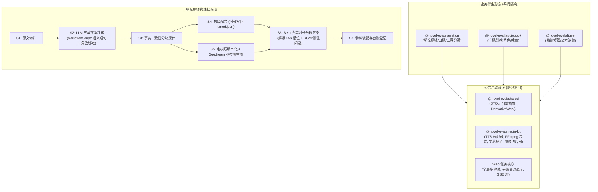

这份方案的业务直觉很敏锐，但在**工程架构、跨包边界、音画对齐算法、状态机设计**上存在致命漏洞。如果直接按照此方案施工，必然在 M1/M2 遭遇大面积返工或线上事故。

以下是工程红队评审报告：

---

## 架构重构蓝图（公共层解耦与精准时间轴）

在展开具体缺陷前，必须纠正方案中“`packages/narration` 直接引入 `audiobook` 私有实现”的错误架构倾向。工业级工程应向下沉淀**统一多媒体核心能力**，并建立由 **Beat 精确时间驱动**的音画对齐流水线：



---

## P0 必须改（照做会翻车）

### 1. `video.ts` 的 `timedScenes` 存在 25s 强制量化槽，音画对齐承诺必然翻车
- **问题**：PLAN §3 S6 声称“复用 `video.ts` 渲染栈：已预留 `RenderOpts.timedScenes`（按 startS 对齐分镜）……正好喂这个接口”，并在 §8 承诺“音画对齐误差 <0.5s”。实际上，`video.ts` 的 `assignSegments` 根本不是任意时间戳分镜对齐接口，而是将分镜强行吸附到 25s 的固定槽位网格上。若 beat 间隔为 5s、12s 或 18s，分镜切换与台词错位最大可达 12.5 秒，短镜头（如前 3 秒钩子）会被完全吞掉。
- **证据**：
```52:66:packages/audiobook/src/video.ts
export function planSlots(
  durS: number,
  snowPeriodS: number | null,
  maxSlotS = 25,
  minTailS = 4,
): Slot[] {
  if (durS <= 0) throw new Error('planSlots: 时长必须为正');
  const frames = Math.ceil(durS * VIDEO_FPS);
  const total = frames / VIDEO_FPS;
  let std = snowPeriodS && snowPeriodS > 0
    ? Math.floor((maxSlotS + 1e-6) / snowPeriodS) * snowPeriodS
    : maxSlotS;
  if (std < 1) std = maxSlotS;
  let nStd = Math.floor((total - minTailS) / std);
  if (nStd < 0) nStd = 0;
```
```97:118:packages/audiobook/src/video.ts
    for (const s of slots) {
      const slotMid = currentSlotStart + s.durS / 2;
      let activeScene = sortedScenes[0];
      for (const scene of sortedScenes) {
        if (scene.startS <= slotMid) {
          activeScene = scene;
        } else {
          break;
        }
      }
      const img = activeScene.img || covers[0];
      const last = out[out.length - 1];
      if (last && last.img === img) {
        last.durS = Number((last.durS + s.durS).toFixed(3));
      } else {
        out.push({ img, durS: s.durS });
      }
      currentSlotStart = Number((currentSlotStart + s.durS).toFixed(3));
    }
    return out;
```
- **改法**：
  解说视频默认不开雪花（无需锁相周期对齐），**禁止调用 `planSlots` 强行划分 25s 槽位**。新建基于精确时钟驱动的切片逻辑：以每个 beat 的实际配音时长 `durS` 直接生成 `PlannedSegment`；超长镜头（如单镜头超过 20s）再做均分切片。

---

### 2. 跨包 import 私有模块违反 ESM exports 限制与 SOLID 架构边界
- **问题**：PLAN §4 规定 `packages/narration` 的 dependencies 引 `audiobook（tts/video/srt）`。但在 Node.js ESM 规范下，跨包导入未导出的内部路径会直接抛出 `ERR_PACKAGE_PATH_NOT_EXPORTED`。更严重的是，`audiobook` 的 `index.ts` 根本没有导出 `synthesizeWithGate`（它是 `cli.ts` 的私有函数）、未导出 `srt.ts` 的任何函数、未导出 `video.ts` 的核心类型。把业务包 `audiobook` 当公共库引用，严重违反依赖倒置原则（DIP）。
- **证据**：
```7:10:packages/audiobook/package.json
  "exports": {
    ".": "./src/index.ts",
    "./cli": "./src/cli.ts"
  },
```
```1:15:packages/audiobook/src/index.ts
export { annotateChapter, DEFAULT_VOICE_CONFIG } from './annotate.ts';
export type { Segment, SegmentKind, VoiceConfig } from './annotate.ts';
export { openWriterDb, loadChapters, listProjects, resolveProjectId } from './db.ts';
export { createEngine } from './tts/index.ts';
export type { TtsEngine, SynthResult } from './tts/index.ts';
export { assembleChapter } from './audio.ts';
export { renderChapterVideo } from './video.ts';
```
```161:164:packages/audiobook/src/cli.ts
async function synthesizeWithGate(
  engine: TtsEngine, segments: Segment[], ttsDir: string, label: string,
): Promise<SynthResult[]> {
  let synth = await engine.synthesize(segments, ttsDir);
```
- **改法**：
  严禁跨包私自引用。将 `tts/`、`ffmpeg.ts`、`video.ts` 的通用渲染内核以及 `srt.ts` 抽离下沉到独立包 `@novel-eval/media-kit`（或先收敛至 `@novel-eval/shared/media`），`audiobook` 和 `narration` 均作为平行上层消费方引入。

---

### 3. NarrationScript Beat 数据结构残缺，S4–S6 管道直接断链
- **问题**：PLAN §3 S2 定义的 beat 数据结构为 `{ text, scenePrompt, kind }`。该结构存在三大致命缺陷：
  1. **缺少出场角色绑定**：S5 声称“把当帧出场角色的定妆照作为 `image` 参考图传入（1–3 张）”，但数据结构中根本没有 `characterIds`，S5 无法在无人干预下自动匹配定妆照；
  2. **缺少稳定唯一标识**：缺少 `id`（如 `b001`）和内容哈希指纹，文案微调或失败重试时数组索引错位将导致音画大面积窜位；
  3. **字数与字幕粒度冲突**：单个 beat 定义为 80–160 字（口播长达 20–40 秒），若单 beat 对应一条字幕，屏幕文字将长达半分钟不刷新，且 `estimateCues` 在 30 秒长音频下比例估算会累积 2~3 秒严重不同步。
- **证据**：`research/narration-video/PLAN.md:48, 61-63`
- **改法**：在 `packages/shared/src/dto/narration.ts` 中建立两层严密类型约束：

```typescript
export interface NarrationSentence {
  id: string;              // 如 b001-s01，15-30 字
  text: string;
  durationMs?: number;
  srtCue?: { startMs: number; endMs: number };
}

export interface NarrationBeat {
  id: string;              // 如 b001
  kind: 'hook' | 'turn' | 'peak' | 'close';
  sentences: NarrationSentence[]; // 细粒度台词句
  visual: {
    prompt: string;
    characterIds: string[];      // 明确声明依赖的角色定妆照 ID
    styleOverride?: string;
  };
  durationMs?: number;           // S4 执行后回填
}

export interface NarrationScript {
  bookId: string;
  targetMinutes: number;
  beats: NarrationBeat[];
  characters: Array<{ id: string; name: string; sheetUrl: string }>;
}
```

---

### 4. 定妆照→参考图生图缺乏 API 契约验证，状态机与级联失效缺失
- **问题**：
  1. **API 参数凭空假设**：PLAN §7 自认“参考图参数确切格式以 M1 样品实测为准”。而在目前 `gen-scenes-ark.ts` 中完全未接参考图。Seedream 5.0-lite 的官方接口中多图参数名为 `image` 还是 `ref_image`、单次允许传入几张、是否支持 Base64、单图大小限制等均未核实；
  2. **级联缓存失效（Cascade Invalidation）缺失**：若人工更换了某角色的定妆照，定妆照文件路径不变但内容改变，若生图缓存键未纳入参考图的内容哈希（SHA-256），后续分镜图将直接复用旧图缓存；
  3. **缺乏定妆照确认状态机**：若 Web 端点击“一键出片”，而定妆照尚未生成或挑选确认，管线是盲选还是挂起？方案未定义任何前置确认状态。
- **证据**：
```86:92:packages/audiobook/gen-scenes-ark.ts
      const res = await fetch(ENDPOINT, {
        method: 'POST',
        headers: { 'Content-Type': 'application/json', Authorization: `Bearer ${apiKey}` },
        body: JSON.stringify({ model: MODEL, prompt, size: SIZE, response_format: 'url' }),
        redirect: 'error',
      });
```
- **改法**：
  - **强制建立 M0 Spike**：在编写任何 S2–S5 业务代码前，先写一个单脚本验证 Seedream 5.0-lite 传 1~3 张参考图的实际调用，封固入参 Schema；
  - **指纹级联**：分镜生图缓存键必须由 `hash(prompt + style + refImages.map(sha256))` 派生；
  - **状态机门禁**：在 Registry 增加 `CharacterSheetStatus: 'draft' | 'approved'`，未 approved 前禁止启动 S5 分镜批量渲染。

---

### 5. Web Spawn 串行锁为模块内单点，跨管线并发将压垮宿主机
- **问题**：`packages/web/server/routes/audiobook.ts` 里的 `currentJobId` 是**该路由文件内部的局部内存变量**。若新写 `routes/narration.ts` 并复制一套该逻辑，两者互不知晓。当用户在 Web 端同时触发有声书和解说视频渲染时，宿主机将同时运行两个 1440p24 x264 极其繁重的转码进程，直接违反 PLAN §6 的“渲染一律串行铁律”，导致 CPU 满载宕机。此外，`pipeline-spawn.ts` 依赖单盘写死的 `.job-pending-args.json`，并发写入会产生严重竞争覆盖。
- **证据**：
```203:204:packages/web/server/routes/audiobook.ts
const jobs = new Map<string, AbJob>();
let currentJobId: string | null = null;
```
```618:620:packages/web/server/routes/audiobook.ts
    if (currentJobId && jobs.get(currentJobId)?.status === 'running') {
      return c.json({ error: '已有任务在跑（渲染必须串行），请稍候或先取消', jobId: currentJobId }, 409);
    }
```
```213:215:packages/web/server/routes/audiobook.ts
  const id = randomUUID().slice(0, 8);
  const pendingArgsFile = join(DATA_DIR, '.job-pending-args.json');
  const { child, argv } = runAudiobookPipeline(pendingArgsFile, REPO_ROOT, jobEnv);
```
- **改法**：
  把任务调度提升至全局 `packages/web/server/lib/job-runner.ts`。实现**分阶段资源锁**：
  - LLM / TTS 阶段：允许单书级并发；
  - FFmpeg 渲染阶段：持有全局互斥锁（Mutex），任何管线进入渲染阶段必须排队；
  - 将 `.job-pending-args.json` 改为带有 `jobId` 的唯一临时文件并在消费后原子销毁。

---

## P1 强烈建议

### 1. 成本台账与 DerivativeKind 契约扩展不严密
- **问题**：`DerivativeKind` 目前为静态联合类型，未包含 `'narration_video'`。现有 `CostEntry` 仅包含 `chars` 与 `engine` 两个字段，无法承载方案 §3 S7 声称的“LLM / TTS / 图三项分记”。若盲目复用，会导致生图费用与 LLM token 费用无法持久化。
- **证据**：
```15:16:packages/shared/src/derivative-work.ts
/** 衍生形态种类（M3 项为预留，未实现前不得写入各自 registry 之外的位置） */
export type DerivativeKind = 'audiobook' | 'digest' | 'screenplay' | 'comic_drama' | 'ai_short';
```
```8:18:packages/audiobook/src/cost-ledger.ts
export interface CostEntry {
  ts: string;              // ISO 时间
  projectId: string;
  bookTitle: string;
  ep: number;
  engine: string;
  chars: number;           // 本章范围正文字数
  durationMs: number;      // 成片时长
  estCostYuan: number;     // 估算成本（元）
  isDraft: boolean;        // --chars 试产
}
```
- **改法**：
  在 `shared` 中扩展 `DerivativeKind = ... | 'narration_video'`。为解说重构专用账本或建立通用多维台账：`{ llmTokens: number; ttsChars: number; imageCount: number; costBreakdown: { llm: number; tts: number; image: number } }`。

---

### 2. 遗漏背景音乐（BGM）侧链避让混音，长视频听感灾难
- **问题**：长达 20–35 分钟的解说视频，若是纯单一 TTS 人声干音口播，听感极其单调乏味。仓库在 `packages/audiobook/src/audio.ts` 中已经实现了极其优雅的 `mixBgmWithSidechainDucking`（侧链避让混音），但整个 PLAN 从头到尾未提及 BGM 的选配与装配逻辑。
- **证据**：
```100:110:packages/audiobook/src/audio.ts
/**
 * 将人声音频与背景音乐做动态避让混音（Sidechain Ducking）
 * 输出为主轨长度相同的成品音频。
 */
export async function mixBgmWithSidechainDucking(
  speechFile: string,
  bgmFile: string,
  outFile: string,
  opts: MixBgmOptions = {},
): Promise<number> {
```
- **改法**：
  在 S6 合成前增加 BGM 装配配置项（可预设 2~3 首悬疑氛围背景音乐），在口播音频合并后直接通过侧链压缩滤镜将人声与 BGM 自动压低避让混音，输出饱满的成品音轨。

---

### 3. 里程碑切分逻辑倒置，核心技术黑盒未前置
- **问题**：PLAN §5 将 M1 定为“文案+配音闭环”，把最具不确定性的“Seedream 参考图生图+一致性抽检”推迟到 M2。这是典型的“避重就轻”。如果在 M1 耗费大量精力跑通文案配音，到了 M2 发现 Seedream 的参考图一致性达不到商用要求（例如脸部扭曲、风格撕裂），将导致项目卡死。
- **证据**：`research/narration-video/PLAN.md:101-105`
- **改法**：
  设立 **M0：技术预研与微原型（Spike）**：
  1. 调通 Seedream 参考图 API 探针；
  2. 针对指定角色输出 2 张定妆照 + 3 张分镜，肉眼判定一致性；
  3. 制作一个 30 秒的短片微原型，验证“Beat 精确时长切片”与音画同步。通过后再启动 M1 全量文案流水线。

---

### 4. S3 事实一致性 Probe 缺乏长文本分块比对机制与容差标准
- **问题**：原著 4 万字，解说词 8 千字。若将全文一次性投喂给 LLM 进行“事实一致性核对”，单次上下文超 50k tokens，存在严重的“大海捞针”遗忘和幻觉。更严重的是，解说文案本就需要“艺术加工、反转前置、情节压缩”，若没有量化的容差规则，Probe 会产生大量误报从而阻断出片。
- **证据**：`research/narration-video/PLAN.md:68-69`
- **改法**：
  严禁全文硬比。复用 S2 map 阶段产生的各章节摘要，以“章节关键事实表”对比解说词的各幕，重点探查：核心人物死活状态、凶手身份、关键物证是否被颠倒；对叙事顺序的调整予以豁免。

---

### 5. Seedream 顺序串行生图耗时过长且缺乏缺图容错
- **问题**：按 30 分钟视频 ~70 张图计算，单张 12s 节流 + 20s 响应耗时，顺序执行总耗时高达 35 分钟。若第 68 张因偶发网络波动或违禁词报错，`gen-scenes-ark.ts` 记录 `fails` 后退出，下游 S6 渲染因找不到图片直接崩溃，导致整条长流水线报废。
- **证据**：
```138:141:packages/audiobook/gen-scenes-ark.ts
  }
  console.log(`完成，失败 ${fails.length}：${fails.join(' ')}`);
}
```
- **改法**：
  1. 引入 2 路微并发（火山 API 普遍支持小并发，配合指数退避）；
  2. S6 必须具备缺图容错能力：若某个分镜生成失败，自动 fallback 沿用上一帧画面或该分镜出场角色的定妆照，并打出警告，绝不能中途崩溃。

---

## P2 可选

### 1. 豆包 TTS 句级时间戳估算在长句中存在累积漂移
- **证据**：`packages/audiobook/src/srt.ts:13-33`
- **建议**：`estimateCues` 是按字数线性分配时间。在解说语境下，若口播有语气停顿，可能导致字幕快慢不均。建议在 S2 生成文案时，Prompt 显式要求单句不得超过 25 字，并在标点符号处做强制物理切断。

### 2. YouTube 章节锚点密度控制
- **证据**：`packages/audiobook/src/cli.ts:498-511`
- **建议**：YouTube 要求章节至少 3 个且每个间隔 ≥10s。解说视频的 beat 很多，需编写专门的聚合函数，仅将 `kind: 'hook'`、`kind: 'turn'`、`kind: 'peak'` 这类大幕节点转化为 YouTube Chapters，避免把几十个微 beat 全部塞入导致简介超长。

---

## 总评

这份方案**目前绝对不能直接开工**；其核心症结在于方案设计者将“有声书业务代码”误当成了“基础设施底层”，并且把“长音频的粗粒度轮播切片器（25s 槽）”盲目套用在“高精度口播分镜（Beat 级）”上，同时把关键的 Seedream 参考图 API 探针与多图一致性风险推迟到了 M2。

**开工的最关键前置条件是：先完成 M0 阶段的“技术探针与公共层剥离”——通过独立 Spike 脚本实测跑通 Seedream 5.0-lite 的参考图 API 真实传参并产出 30 秒音画严格对齐的微原型，同时将 TTS、FFmpeg 及视频渲染切片器从 `packages/audiobook` 中解耦抽离为独立的公共多媒体模块。**
