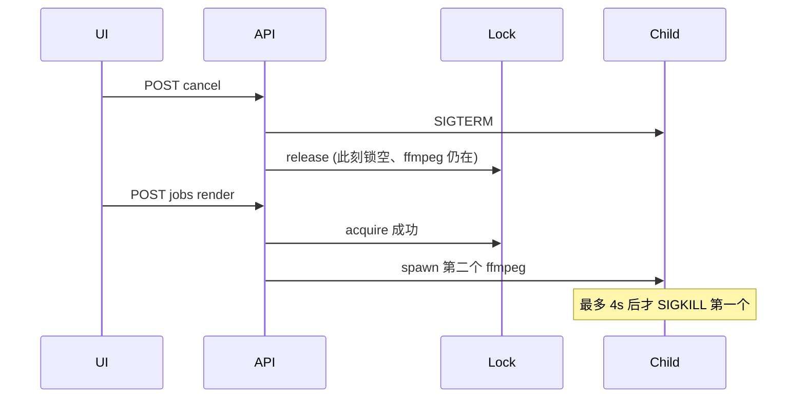

# M3 代码评审（Cursor）

## ① 总评

方向对，不是最佳，**带着 P0 不能上线**。

全局 `render-lock`、产物派生状态、registry 驱动 spawn、`registryRoot` 落在 `dist/` 内——这些约束都接到了位。有声书 `currentJobId` → 共享锁的替换，jobId 作用域释放比旧代码更好（旧逻辑会在「取消 A 后启动 B、A 的 close 把 B 的锁清掉」）。集成验收（跨路由 409、成片、检查单 DOM）说明主路径能跑通。

但锁的**生命周期协议是错的**：`cancel` 在子进程还活着时就放锁，等于专门为防双 ffmpeg 加的锁被「取消再立刻重跑」一键打穿。前端有现成 SSE（有声书 `JobConsole`）不用，改抄 digest 轮询还把 `load` 绑上 `job`，每 2s 重建 interval 并打状态/台账/ffprobe。检查单 PUT 整文件覆盖、TTS 账按文稿字数而非本跑 API 实耗——都是会在真实使用里踩到的。

修完 P0 + 所列 P1 可以上线。不要在锁协议未修时抽 `job-runner.ts`。

---

## ② 问题清单

### P0 必须修

**P0-1 取消立即放锁，双 ffmpeg 窗口就是产品主路径**
- **位置**：`packages/web/server/routes/narration.ts:485-493`（cancel）、`:142-147`（close）；对照 `packages/web/server/routes/audiobook.ts:752-761`、`:258-268`（同构，M3 共享锁后危害跨路由）
- **问题**：cancel 立刻 `releaseRenderLock`，子进程只收到 SIGTERM、4s 后才 SIGKILL。GET `/jobs/active` 随锁变空，UI 认为空闲，下一发 POST `/jobs` 能占锁并再 spawn。这正是 16GB Mac 并行渲染压死的场景；「取消卡住的成片 → 马上再渲」或「取消解说 → 切有声书开构建」都会打中。error/close 的 jobId 作用域释放是对的（旧 `currentJobId = null` 会误清下一把锁），唯独 cancel 抢跑。
- **最小修法**：cancel 只 `kill`，**不放锁**；放锁只留在 `close`/`error`。`if (job.status === 'cancelled')` 时 close 不得改写成 `completed`、不得 `billJob`。前端 busy 以锁为准，取消后继续 409 直到进程真正死掉。

### P1 应该修

**P1-1 检查单 PUT 不合并，单键写入会抹掉其余勾选**
- **位置**：`packages/web/server/routes/narration.ts:507-521`；前端 `packages/web/src/pages/BookNarration.tsx:128-132` 每次只 POST `{ [k]: v }`
- **问题**：服务端从空对象只填本次出现的 key，再整文件覆盖。连续勾 5 项，磁盘上只剩最后一项为 true。本地 state 看起来全勾，刷新、`load()`（任务结束必走）后其余项变 false。对齐了有声书的错误先例，不是对齐了正确契约。
- **最小修法**：读已有 `publish-checklist.json`，只 patch 出现的 key，再写回。前端亦可一次提交全量，但服务端必须能合并，否则任何部分更新都是数据丢失。

**P1-2 轮询依赖环：每 2s 重建 interval，并额外打状态/成本/ffprobe**
- **位置**：`packages/web/src/pages/BookNarration.tsx:68-96`
- **问题**：`load` 依赖 `[bookId, job]`，轮询 effect 依赖 `[job, load]`。每次 `setJob({ ...job, ...j })` 换了 `job` 引用 → `load` 换身份 → 立刻再 GET 书状态+成本；interval 被清掉重建。有声书已有 `JobConsole` + `EventSource(/jobs/:id/stream)`（只依赖 `job.jobId`）。解说路由也实现了 SSE，前端不用。digest 的 `load` 只依赖 `bookId`，解说比 digest 还差一档。
- **最小修法**：复用/抽出 `JobConsole`（SSE）。若暂留轮询：`load` 去掉 `job` 依赖（`activeJob` 采纳用 `jobRef`）；effect 依赖 `job.jobId` + `job.status`；`setJob` 用函数式更新。任务结束再 `load()`。

**P1-3 `activeJob && !job` 会漏接刷新后的日志；切书不重置 job**
- **位置**：`BookNarration.tsx:62`、`:75`、`:68-80`
- **问题**：刷新后 `job===null`，采纳 `activeJob` 时 `lines: []`，还要等一个 2s tick 才拉到尾日志（SSE 会先回放缓冲）。`job` 不按 `bookId` 复位：从书 A 点到书 B，A 的 running job 会让 B 全按钮 `busy`，且因 `!job` 为假而不采纳 B 自己的 `activeJob`。有声书 `load` 不绑 job，没有这条。
- **最小修法**：`useEffect(() => setJob(null), [bookId])`；采纳 running 任务后立刻 GET `/jobs/:id` 或直接开 SSE。`job.bookId !== bookId` 的状态丢弃。

**P1-4 audio 账按文稿总字数，缓存命中仍全额计费**
- **位置**：`packages/narration/src/cli.ts:118-119`；`packages/audiobook/src/tts/volcengine.ts:184-186`（`cacheHit` 直接 skip API）
- **问题**：`ttsChars` = 全部 `sentence.text.length`。引语是换声不是双合成，1:1 口径本身对。但 TTS 段文件+指纹缓存是一等公民，「重跑配音」几乎零 API 仍会 `recordUsage` 全文稿字数，`billJob` 再 append 一条 ¥2/万字。台账变成「文稿长度×重跑次数」，不是「本跑烧了多少」。
- **最小修法**：`buildAudio` 返回本跑实际送进引擎的字数（未命中缓存的 segment）；`recordUsage('audio', { ttsChars: synthesized, cachedChars, durationMs })`。`billJob` 只用 `ttsChars`。

**P1-5 `checked` 默认 maxLen=64，长书名建线成功但所有 job 422**
- **位置**：`narration.ts:79-83`、`:394`；`slugify` 截 40 字（`:49-51`）+ 前缀 `dist/derivatives/`(18)+`/narration`(10) = 最长 **68**
- **问题**：正则写着 `{3,120}`，真正卡死的是默认 64。setup 不走这条 `checked`，用户能建线、不能跑任何一步，报「参数 outRoot 非法」。有声书同样 64 vs 路径最长 68，解说原样继承。中文 20 字书名没事；slug 满 40 或偏长标题必炸。
- **最小修法**：`checked(rec.outRoot, regex, 'outRoot', 128)`；setup 当时就算一遍。不要用默认 64 去套路径。

**P1-6 audiobook regen：check 后 await json，且先删图/spawn 再 acquire**
- **位置**：`audiobook.ts:800-814`；`packages/web/server/lib/scene-regen-runner.ts:27-46` 在 `acquireRenderLock` 之前就 `rmSync` + `spawn`
- **问题**：POST `/jobs` 两条路由都是「先 json、再 check、其后同步 acquire」，Node 单线程下 **没有** TOCTOU。真正的间隙在 regen：check → `await req.json()` → spawn/删图 → acquire。解说任务可在 await 时插入、占锁；随后 acquire 抛错（有声书 catch 不到，变 500），子进程无锁跑、图已删。共享锁把「自家撞车」升级成「跨路由插入」。
- **最小修法**：json 校验全部完成后再 check；**先 acquire 再 spawn/删图**；acquire 失败返回 409 且不得改磁盘。`startNarrJob` 也应改成先占锁再 `runPipeline`（现是 spawn 后 acquire，见 `:113-121`，目前无 yield 所以是地雷不是现炸）。

**P1-7 门禁失败 / 取消成功退出会错账或假完成**
- **位置**：`cli.ts:101-104`（gates 失败 `exitCode=2`，但 `:86` 已写 usage）；`narration.ts:142-145`（`code===0` 即 completed+bill）；cancel 后 ffmpeg 偶发 0 退出（待验证，逻辑上已错）
- **问题**：脚本 LLM 已花、因果门（又一次 LLM，见下）失败 → 不落账。cancel 后 close 用退出码覆盖 `cancelled`，0 则当成成功并 bill。半成品 mp4 会被 `scanOutRoot` 当成成片。
- **最小修法**：close 若当前已是 `cancelled`/`failed` 则只放锁。脚本无论门是否绿都应把 `llmCalls` 落账（或 usage 里分开 `billed`）。因果门那次 LLM 计入 `llmCalls`（`gates.ts:119-128` 在 `recordUsage` 之后，现在漏记）。

### P2 可选

**P2-1 锁粒度过粗**：script/audio/sheets/scenes 全部占「渲染锁」。16GB 上偏保守可以接受，但 409 文案写「渲染必须串行」会误导。若以后要边写解说边做有声书 listen，再分级（ffmpeg 互斥 vs 轻任务）。现在不要拆。

**P2-2 进程内单例 vs 崩溃**：单进程 `tsx server/index.ts` 够用。崩溃/重启锁自然空是对的。`index.ts:139-140` SIGINT/SIGTERM 只 `closeDb`，不杀管线子进程 → 孤儿 ffmpeg + 新进程空锁。退出前按 lock holder 杀进程组。不要上文件锁，除非以后多进程。

**P2-3 `outRoot` 正则挡不住 symlink**：`[\w\u4e00-\u9fff/-]` 不含 `.`，`..` 过不了 `checked`；`registryRoot` 用 `resolve` 前缀检查，与有声书双保险同构。`resolve` 不跟 symlink。登记文件本机可写，威胁模型与有声书相同。要加就两边一起 `realpath`。

**P2-4 `minutes` spawn 未走 `checked`**：`narration.ts:397` `String(rec.presets.minutes)`。登记被手改成带 `-` 的值可变成选项。setup 白名单是 8|10|12|15|20|25|30；UI 只有 8/12/15/25/30，缺 10 和 20。

**P2-5 `probeDurationMs` 同步打 event loop**：`narration.ts:66-76`，GET 状态会 probe mp3/mp4/shorts。mtime 缓存后单次 ~几十到两百 ms；冷缓存+3 条 shorts 能到数百 ms。有声书集墙更重。P1-2 修掉后不会每 2s 打一次。要异步化两边一起改，别只改解说。

**P2-6 `scanOutRoot` 损坏 JSON / 半成品**：`loadJson` 失败变 null，UI 会闪「没脚本」。有 timed 无 script 时用 timed（角色可能旧）。任务写文件时 GET 撞残 JSON 是轮询通病。可接受。`statSync` 在 exists 与 probe 之间文件消失会 500（未 catch）。

**P2-7 抽 `job-runner.ts` 现在不要做**：~120 行复制（start/feed/SSE/cancel）属实。收益是下一形态少复制；风险是把 P0 锁协议再封装错一次，且 regen 这条野路子还在外面。先把 cancel/close/acquire-before-spawn 收成一个函数，观察一版，再抽。digest 轮询更脏，不要以它为模板。

**P2-8 双源真相**：`jobs Map` + lock holder。`activeNarrationJob` = 锁.kind 匹配再 `jobs.get`。取消抢跑时两者不一致（这就是 P0）。正确模型：锁 = 是否允许新 spawn；Map = 日志/SSE。不要把 job 对象塞进锁模块。

**P2-9 单价常量**：`registry.ts:81` `NARRATION_UNIT_COST` 一处收口，注释已写「展示口径」。做成配置收益低。重跑 append 是**特性**（真花了两次就该两条）；缺的是 UI 写清「累计消耗」而不是「本片成本」，以及 P1-4 缓存不应计入。

**P2-10 `/media`**：`rewriteRequestPath` 剥 `/media` 是 Hono 官方姿势（[nodejs serveStatic](https://hono.dev/docs/getting-started/nodejs)）。`root: './dist/media'` **不适用**——产物在 `dist/derivatives/…`，不是 `dist/media/`。库在 decode 后用 `/(?:^|[\/\\])\.{1,2}(?:$|[\/\\])|[\/\\]{2,}/` 拒 `..` 与双斜杠，无穿越。可改进：官方也支持绝对 `root`（`fileURLToPath`），可去掉 `relative(cwd)`。`replace(/^\/media/, '')` 会留下前导 `/`，Darwin 上 `path.join('dist','/derivatives/x')` 仍得到 `dist/derivatives/x`，能工作；写成 `replace(/^\/media\//,'')` 更干净。

**P2-11 Vite `/media` 代理**：只加了 HTTP 前缀，与 `/api` 并列；HMR websocket 仍走 5173，不会误伤。大 mp4 整文件下载是否撞 proxy timeout：**待验证**；播放走 Range，库支持 206。

**P2-12 其它**：`jobs`/`durCache` 不淘汰；非 0 退出一律标 `cancelled`；`setupNarrationLine` 注释「原子写」实为 read-modify-`writeFileSync`；approve 与 sheets 同时写 `script.json`（UI 有 busy，API 无）；无 render-lock/checklist/billJob 单测；`BookTabs.tsx:2` 注释还写着「写作 | 有声书 | 短篇」。

---

## ③ 八问简答

1. **锁与并发**：进程内单例对当前单进程够。崩溃释放锁正确，但要处理孤儿 ffmpeg（P2-2）。POST `/jobs` 的 json 在 check **之前**，check→acquire 无 await，**不是** TOCTOU；硬兜底 `acquire` 抛 `RENDER_LOCK_BUSY` 在解说侧收成 409，有声书 POST 收成 422（不对称， practically 到不了）。真间隙在 regen（P1-6）。close/error/regen 释放覆盖了；cancel 覆盖了但**过早**（P0-1）。jobId 作用域释放比旧 `currentJobId=null` 更不容易误清下一把锁。
2. **安全**：用户输入不进 fs 路径、spawn 字面量+`checked` 禁 `-`、approve ids `^c-[\w-]{1,32}$`、checklist 只认固定 key、mediaUrl 分段 encode——与有声书同级。`..` 过不了 outRoot 正则。symlink 两边都没堵。解说独有缺口：`minutes` 未 `checked`（P2-4）、outRoot maxLen 64（P1-5）。有声书堵了、解说没堵的面：**没有**（maxLen 两边都堵过死）。
3. **状态派生**：坏 JSON → 当没有，半成品能显示 timed/角色分叉；并发写会闪空。可接受。`probeDurationMs` 请求路径同步阻塞，代价见 P2-5；不要只给解说开小灶异步。
4. **前端**：`scriptReady/gates/audioReady=timed/sheetsReady=人人有图/scenesReady=count>=beats` 与后端字段语义一致；`approvedAll` 另要 status+文件。步骤 3 不挡在 audio 之后是故意可并行。轮询依赖是真 bug（P1-2）。`!job` 采纳会空日志，切书会吞错任务（P1-3）。
5. **架构**：不要现在抽 `job-runner`（P2-7）。锁 + Map 双源可以，职责分开即可；先修协议。前端应复用有声书 SSE 控制台，而不是再复制一份轮询。
6. **成本台账**：schema（llm/tts/image + duration）和「成功 close 后读 usage.json」合理。单价常量化够用。同 stage 重跑 append = 累计花费特性，UI 需标明；bug 是缓存命中仍按文稿计费（P1-4）和门禁失败/因果门漏记（P1-7）。render 条目 0 元只记时长，合理。
7. **`/media`**：剥前缀是正道，不要改成 `root: dist/media`。Vite 代理补丁完整，HMR 无误伤。绝对 `root` 更不易被 cwd 回归。
8. **CLI `usage.json`**：`recordUsage` 覆盖该 stage 键 = 最后一次跑的表计；`billJob` 每次成功 append = 累计。组合下：**不会在 usage 里算重，会在 ledger 里按次累加**（这是对的）。算漏：exit≠0 已写 usage 但不 bill；下一次成功覆盖 usage，失败那次的钱从台账消失。audio 键的 chars 是文稿长度不是本跑 API 字数（P1-4）。

---

## ④ 验证过什么

- 通读评审清单内新增/修改文件，对照 `pipeline-spawn.ts`、`scene-regen-runner.ts`、`audio.ts`/`gates.ts`/`images.ts`、有声书 `JobConsole`、digest 轮询、`@hono/node-server` `serve-static.js`（decode 后拒 `..`/`//`，Range 206）。
- 对照 Hono 官方 Node `serveStatic` + `rewriteRequestPath` 文档；`path.join('dist','/derivatives/x')` 在 darwin 下仍为 `dist/derivatives/x`。
- `git diff` 有声书锁替换：close/error/cancel/regen 四条都从 `currentJobId=null` 换成 `releaseRenderLock(job.id)`，无遗漏释放；cancel 抢跑是旧行为被共享锁放大。
- `pnpm --filter @novel-eval/narration typecheck` 通过；`pnpm --filter @novel-eval/web typecheck` 通过；`pnpm --filter @novel-eval/narration test:unit` 6/6。
- **未跑**：全仓 354、任何 ffmpeg/TTS/生图/渲染、`/media` 实请求、浏览器。未改仓库其它文件。
