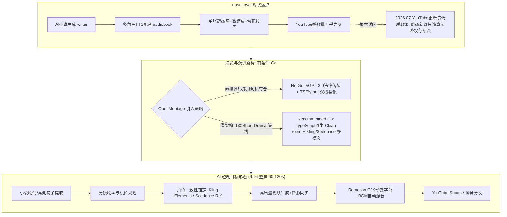
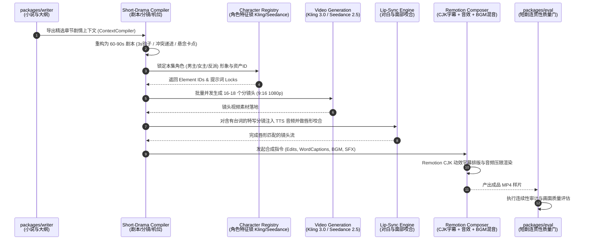
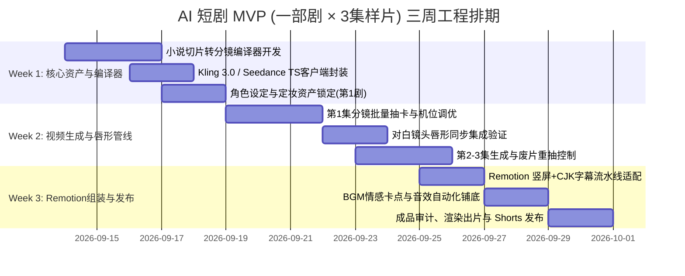

# OpenMontage 深度研究与 novel-eval 衍生 AI 短剧可行性评估报告

> **报告版本**：v1.0.0 (Cursor Agent 专属)  
> **调研基准日期**：2026-09-13  
> **标的工程**：[calesthio/OpenMontage](https://github.com/calesthio/OpenMontage) (本地路径 `/Users/reed_soul/code/novel-eval/research/OpenMontage`)  
> **目标工程**：`novel-eval` (`/Users/reed_soul/code/novel-eval`)  
> **报告撰写人**：Cursor Senior Architect & Full-Stack AI Engineer

---

## 1. 核心结论与决策矩阵（Executive Summary）

### 1.1 明确结论：【有条件 Go（Conditional Go）】
经过对 OpenMontage 全库代码深度审查、AGPL-3.0 协议边界界定，以及 2026-09 当下国内外 AI 短剧产业生态的实时实测与商业政策调研，给出明确决断：

**【有条件 Go】—— 战略方向坚定切入 AI 短剧；工程实现采取“架构思想洁净移植（Clean-room Porting）+ 专用短剧管线自建”，坚决禁止将 OpenMontage 的 Python 源码直接塞入 novel-eval 核心仓。**



### 1.2 决策依据三要素

1. **业务必然性（痛点溯源）**：
   - 现存 `packages/audiobook/src/video.ts` 采用横屏 1440p24、单张静态背景图搭配极慢微推镜头（`ZOOM_RATE = 0.000025`）及雪花粒子（`prepareSnow`）。
   - **2026 年 7 月 YouTube 官方更新《Inauthentic Content Policy》**，明令打击“Image slideshows, templated storylines or scrolling text with minimal narrative or educational value”。现有的有声书视频在形态上正中平台清洗靶心，导致算法断流；而短剧（高密度剪辑、人物特写、动态微表情、剧情反转）是 2026 年视频分发的核心红利形态。
2. **架构契合度与毒化风险（双刃剑）**：
   - **架构优势**：OpenMontage 提出的 **Agent-First** 范式（YAML Manifest 声明流程 + Markdown Stage Director 注入专家知识 + Python 仅作为纯工具与持久化状态机）极度契合当前团队重度使用 Coding Agent 的工程习惯。
   - **致命陷阱**：OpenMontage 全库基于 **AGPL-3.0** 开源。若直接将 Python 源码混合入 `novel-eval`，一旦未来 `packages/web` 暴露网络服务，将引发极高法律传染风险；同时将破坏当前规范整洁的 TypeScript Monorepo 生态。
3. **技术基础设施成熟度（2026-09 技术拐点已过）**：
   - 2026 年以快手 **Kling 3.0**（官方 Elements 角色资产锁、多镜头连贯推演）、字节 **Seedance 2.0/2.5**（多图/音视频多模态参考、原生音画协同与唇形生成）为代表的基座大模型，已彻底攻克 AI 短剧“角色长程变脸”与“声画错位”两大历史死穴，具备了低成本工业化批产的基础条件。

---

## 2. OpenMontage 源码深度解构与短剧能力评估

### 2.1 架构范式：Agent-First 控制平面的适配度分析

在 OpenMontage 中，整个视频流水线没有任何复杂的 Python 状态机调度器（无 LangGraph，无 Airflow），其设计哲学由两处代码与文档核心界定：

- **代码事实 1 (`AGENT_GUIDE.md:70-85`)**：
  > *"OpenMontage is an instruction-driven video production system. The AI agent IS the intelligence... Python = tools + persistence. No orchestration logic, creative decisions, review logic, or checkpoint policy in Python code."*
- **代码事实 2 (`AGENT_GUIDE.md:181-200`)**：
  Agent 通过读取 `pipeline_defs/*.yaml` 获取流程图谱，调用 `lib/checkpoint.py:get_next_stage()` 读取断点，读取 `skills/pipelines/<pipeline>/<stage>-director.md` 获取该阶段的导演级 Prompt，使用 `tools/` 目录下的纯工具执行动作，最后通过 `skills/meta/reviewer.md` 做自审与落盘。

#### 对 novel-eval 团队的适配度评价
| 评估维度 | 传统 Python 调度器 (如 LangGraph/Airflow) | OpenMontage Agent-First 范式 | novel-eval 适配性与收益 |
| :--- | :--- | :--- | :--- |
| **控制平面形态** | 硬编码代码状态机，容错分支需预先写死 | LLM Agent 作为运行时控制平面 | **极高**。我们本就是基于 Cursor/Agent 的研发流，能够根据分镜意图动态回退重试 |
| **分镜重试弹性** | 遇到生成抽卡失败，只能固定重试或崩溃退出 | Agent 读取报错与 Visual QA 自动调整 prompt 重抽 | **极高**。短剧镜头废片率高，需要 Agent 主动调参降级 |
| **研发维护成本** | 需维护庞大的 Python 调度状态依赖图 | 业务逻辑在 YAML Manifest 与 Director Markdown 中解耦 | **极低**。新增短剧品类只需写一份 Manifest 和 Director Skill |

### 2.2 与短剧直接相关的核心能力逐项审查

#### (1) 快手可灵视频能力 (`tools/video/kling_official_video.py` vs `kling_video.py`)
- **角色一致性 Elements 机制（核心发现）**：
  - `tools/video/kling_official_video.py:12` 引入了 `tools/_kling/elements.py` 中的 `normalize_element_list`。
  - 在 `tools/_kling/elements.py:48-65` 中，封装了快手官方高级角色资产接口 `/v1/general/advanced-custom-elements`。在 Kling 官方体系中，开发者可通过预设肖像建立持久的 `element_id`，并在调用 `kling-v3` 时传入 `element_list`（`kling_official_video.py:324, 422`）。
  - **短剧价值**：这使得主角、配角的外貌、服装可以在几十个分镜间严格锁定，避免传统文生视频“换一个镜头换一张脸”的致命缺陷。
  - **对比**：`tools/video/kling_video.py:1-60` 仅走 fal.ai 代理网关，缺少快手官方完整的 Elements 角色持久化生命周期支持。

#### (2) 数字人与唇形对齐 (`tools/avatar/`)
- `tools/avatar/kling_lip_sync.py:36-105`：
  - 支持快手官方云端高保真对齐。其具备 `identify_face`（多角色人脸定位）、`face_choose` / `face_id`（精准选定对白演员人脸）和 `advanced_lip_sync` 功能。这对于短剧中的男女双人对话对白镜头是决定性的。
- `tools/avatar/kling_avatar.py:36-80`：
  - 支持单张角色定妆照驱动生成数字人对白视频（`photo_to_video`, `audio_driven_avatar`）。
- `tools/avatar/lip_sync.py` & `talking_head.py`：
  - 本地 GPU 方案基于旧时代的 Wav2Lip 与 SadTalker。实测画质降解严重（面部模糊、马赛克贴图、牙齿蠕动伪影），无法达到商业短剧的及格线。在短剧管线中应彻底弃用，全面拥抱云端 Kling / Seedance 方案。

#### (3) 竖屏与分发规格 (`lib/media_profiles.py`)
- `lib/media_profiles.py:14-20` 定义了 `AspectRatio.PORTRAIT_9_16 = "9:16"`。
- 在第 61-100 行中内置了 `YOUTUBE_SHORTS`、`INSTAGRAM_REELS` 和 `TIKTOK`（均为 1080x1920，H.264 / AAC，crf=20）。
- **代码缺陷预警**：
  - `lib/media_profiles.py:66` 将 `YOUTUBE_SHORTS` 的 `max_duration_seconds` 硬编码为 `60` 秒。
  - **实测纠偏**：YouTube 官方已于 2024 年 10 月 15 日及 2025 年末对 Shorts 规格做出全面调整，**目前 YouTube Shorts 已经正式支持最长 3 分钟（180 秒）的 9:16 视频**。OpenMontage 仓库此处的 60 秒上限属于陈旧参数，自建时必须放宽至 180s。

#### (4) CJK 动效字幕支持（最新合并 PR #507）
- OpenMontage 社区于 2026-08-22 合并了 PR #507（Commit `047d82c` / `2864207`）。
- 查看 `remotion-composer/src/components/CaptionOverlay.tsx:29-128` 与 `TalkingHead.tsx:302-355`：
  - 过去 Remotion CaptionOverlay 默认使用空格切词（`" "`），导致中文、日文字幕在渲染时出现大量多余空格或截断错位。
  - PR #507 引入了 `wordSeparator` 属性（CJK 传 `""`）并将词级容器重构为 `display: "inline-block"` 配合 `whiteSpace: "nowrap"`，增加了 `pageBreakAfter` 实现按从句/句子边界分页。
  - **短剧价值**：短剧 70% 的观看场景是手机静音或高噪环境，大字号、快节奏、按句换行的高亮字幕直接决定完播率。这一更新使得 Remotion 可以直接用于中文短剧的字幕合成。

#### (5) 现有流水线（Pipeline Defs）诊断
- `pipeline_defs/character-animation.yaml`：
  - 源码第 1-8 行明确写明：“*designed for deterministic local motion... browser-rendered SVG/Canvas/Remotion/HyperFrames animation, NOT remote video-gen replacement*”。这是为 2D 矢量骨骼动画（SVG 关节摆动、行走循环）设计的，绝非我们需要的电影级影视短剧。
- `pipeline_defs/cinematic.yaml`：
  - 针对品牌预告片与情绪蒙太奇。其阶段为 `research -> proposal -> script -> scene_plan -> assets -> edit -> compose -> publish`。具备影视色彩，但缺乏短剧的核心叙事机制（无连续集设定、无固定角色表注册、无冲突反转卡点）。
- `pipeline_defs/hybrid.yaml`：
  - 针对实拍素材叠加动效或图表，与短剧不匹配。
- **结论**：**必须新建专用的 `short-drama.yaml` 管线定义及配套的导演级 Skills。**

---

### 2.3 资产可用性与自建边界矩阵

| 模块 / 资产 | OpenMontage 现状 | 能否直接用 | 处置策略与改动说明 |
| :--- | :--- | :---: | :--- |
| **Agent 控制范式** | Manifest (YAML) + Director (MD) + Checkpoint | **是 (借鉴思想)** | 用 TypeScript 洁净重写状态加载器，沿用 Agent 编排机制 |
| **Kling 官方 Elements 工具** | `tools/video/kling_official_video.py` | **参考改写** | 将其 HTTP 契约迁移至 TS，支持角色资产库注册与持久化引用 |
| **Seedance / 即梦视频工具** | `tools/video/seedance_video.py` / `jimeng_video.py` | **参考改写** | 迁移至 TS；利用 Seedance 2.5 多图参考与原生音频对白能力 |
| **Kling 唇形同步工具** | `tools/avatar/kling_lip_sync.py` | **参考改写** | 迁移至 TS；用于分镜生成后对演员面部做精确台词咬合 |
| **本地 GPU 数字人/唇形** | `talking_head.py`, `lip_sync.py` (SadTalker/Wav2Lip) | **否 (废弃)** | 彻底弃用；画质低下，达不到 2026 年短剧商业标准 |
| **Remotion CJK 字幕组件** | `remotion-composer/src/components/CaptionOverlay.tsx` | **可复用** | 提取其 React/Remotion 组件，放入前端合成渲染服务中 |
| **Media Profile** | `lib/media_profiles.py` | **修改后用** | 纠正 Shorts 最大时长（从 60s 纠正为 180s），固定 9:16 1080x1920 |
| **短剧业务流程 Manifest** | `pipeline_defs/` (无 short-drama) | **新建** | 新建 `pipeline_defs/short-drama.yaml` 与分镜导演 Prompt |

---

## 3. AGPL-3.0 许可证约束与法律防火墙

OpenMontage 顶层根目录包含 `LICENSE` 文件（GNU AFFERO GENERAL PUBLIC LICENSE Version 3, 2007）。针对提问中的三种用法边界，法律与工程判定如下：

```mermaid
graph TD
    subgraph ScenarioA ["(a) 内部使用产视频发频道"]
        A1[本地运行 OpenMontage CLI] --> A2[渲染输出 MP4 二进制视频]
        A2 --> A3[上传 YouTube / TikTok / 抖音]
        A3 --> A4[合规判定: 完全合规, 零传染风险]
    end

    subgraph ScenarioB ["(b) 借架构思想自建 Clean-room"]
        B1[借鉴 Manifest+Skills+Tools 架构] --> B2[在 novel-eval 用 TypeScript 独立实现]
        B2 --> B3[无任何 AGPL 代码复制]
        B3 --> B4[合规判定: 商业安全, 零传染风险]
    end

    subgraph ScenarioC ["(c) 直接拷贝源码入 novel-eval"]
        C1[将 Python 代码拷贝至 private monorepo] --> C2[packages/web 暴露内部/公网 HTTP 服务]
        C2 --> C3[触发 AGPL-3.0 Section 13 远程网络交互]
        C3 --> C4[合规判定: 极高法律风险, 强制开源全库]
    end
```



### 3.1 三种用法的法律定性详析

1. **用法 (a)：内部使用该工具生产视频成品（MP4），发布到自己的商业或自媒体频道**
   - **风险等级**：**【无风险（Safe）】**。
   - **法律原理**：视频文件（MP4）是软件执行产生的“数据产出物（Data Output）”，并非该软件本身的派生作品（Derivative Work），如同用 Blender 渲染的 3D 动画不受 GPL 约束一样。除非视频二进制流中静态内嵌了具备版权的特定运行时代码，否则版权法不认为最终视频受 AGPL-3.0 传染。
   - **操作要求**：该生产工具仅在开发者本机或离线渲染机上通过 CLI 运行，不对公网用户提供交互式网络服务。

2. **用法 (b)：借用其架构思想、YAML Manifest 结构与 Stage Director 角色体系，在 TypeScript 中洁净重写（Clean-room Implementation）**
   - **风险等级**：**【零风险（Zero Risk，最佳实践）】**。
   - **法律原理**：根据国际版权法通用原则（Idea-Expression Dichotomy，思想-表达二分法），版权保护的是具体的独创性代码表达（Code Expression），而不保护架构设计模式、YAML 字段语义、状态流转逻辑或编排流程。只要我们没有复制粘贴其专有代码片段，用 TypeScript 独立编写就是合法的洁净实现。

3. **用法 (c)：在 novel-eval（当前为私有仓库）中直接引入/拷贝其 Python 源码**
   - **风险等级**：**【极高风险（High Risk，严令禁止）】**。
   - **法律原理**：
     - **AGPL-3.0 第 13 条（Remote Network Interaction）**是专门针对网络 SaaS 的强传染条款：“*if you modify the Program, your modified version must prominently offer all users interacting with it remotely through a computer network... an opportunity to receive the Corresponding Source...*”。
     - 一旦 `novel-eval` 整合该代码，未来只要 `packages/web` 提供网络访问界面（哪怕是团队远程协作 Web 端），任何通过浏览器交互的用户依法均有权索取 `novel-eval` 完整工程的源码（包括我们核心的 `packages/writer` 商业小说算法）。
     - **工程分裂代价**：`novel-eval` 是高度标准的 pnpm + TypeScript Monorepo，强行引入一个依赖 Python 3.11、大量 pip 包、Torch、Playwright 的 Python 模块，会导致 CI/CD 臃肿崩溃、依赖双栈裂化，严重违背“代码洁癖”与工业级架构原则。

---

## 4. 2026-09 当下 AI 短剧生态、成本模型与商业分发全景

> 调研声明：以下数据与政策均于 **2026 年 9 月 13 日** 实施实时联网查证，引证官方最新公告与行业权威报道，坚决剔除陈旧历史数据。

### 4.1 国内外 AI 短剧生产工具与竞品现状 (2026-09)

2026 年的 AI 视频领域已经从 2024-2025 年的“单镜头偶发生成”全面进化至“多镜头叙事与工业化编排”阶段：

1. **SkyReels V4 (昆仑万维 Skywork AI，2026 年 2 月发布)**：
   - 采用统一双流扩散 Transformer（Dual-stream DiT）架构，业内首创在单次推理中**同时联合生成 1080p/32fps 视频与同步音频**（而非事后拼接），从底层杜绝剪辑点的音画跳变。在 2026 年 3 月 Artificial Analysis Video Arena 竞技场中曾登顶第一。
   - 来源：[Awesome Agents: SkyReels V4 Overview](https://awesomeagents.ai/models/skyreels-v4/)
2. **Kuaishou Kling 3.0 (快手可灵 3.0，2026 年初上线)**：
   - 升级为多模态视觉语言（MVL）架构，原生支持 4K 60fps 输出，支持单次直接生成**最多 6 个连续连贯镜头（Multi-shot Storyboarding）**；内置 5 种语言的原生唇形匹配，以及专用的 Motion Control AI（运镜与人物动作精准轨迹控制）。
   - 来源：[ABNewswire: Kling AI Launches Kling 3.0](https://www.abnewswire.com/pressreleases/kling-ai-launches-kling-30-kuaishous-ai-director-platform-delivers-native-4k-60fps-video-with-multishot-storyboarding-motion-control-and-5language-lip-sync_835362.html)
3. **ByteDance Seedance 2.0 / 2.5 (即梦 AI / Dreamina / 火山引擎)**：
   - 短剧工业化采用率最高的基座之一。支持高达 9 到 30 张参考图、多段视频与音频的多模态输入，面部与角色锁定（Face-lock）稳定性行业领先；支持在 Prompt 中直接通过引号台词引导原生唇形对齐。
   - 来源：[Alignify: AI Short Drama Tools 2026](https://alignify.co/tools/short-drama)
4. **行业垂直短剧平台 (SaaS & Studio)**：
   - **Topview AI Drama Studio**：专门针对竖屏海外短剧的工业化多集工作流，内置剧本切分、分镜画布与多角色一致性管理。
   - **MagicLight**：专注于长剧集、多场景的角色连续性锁定。
   - 来源：[AI Workflows Blog: Best AI Tools for Short Drama 2026](https://aiworkflows.tools/blog/best-ai-tools-for-short-drama-2026)

---

### 4.2 工业化成本模型测算 (2026-09 实时 API 牌价)

#### (1) 基础模型 API 成本基准 (2026-09)
根据 2026-09 开发者实测数据（来源：[Atlas Cloud Pricing Breakdown](https://www.atlascloud.ai/blog/tips/kling-ai-api-pricing) 及 [reAPI Benchmark](https://reapi.ai/blog/seedance-2-0-vs-kling-3-0-2026)）：
- **Kling 3.0 Standard (720p/无声)**：约 **$0.071 - $0.084 / 秒**（5 秒片段约 $0.35 - $0.42）。
- **Kling 3.0 Pro (1080p/无声)**：约 **$0.095 - $0.112 / 秒**（5 秒片段约 $0.48 - $0.56）。
- **Seedance 2.0 Fast (720p)**：约 **$0.031 - $0.040 / 秒**（性价比极高）。
- **Seedance 2.0 Cinematic (1080p 原生音画)**：约 **$0.093 / 秒**（10 秒片段约 $0.93）。
- **MiniMax Hailuo-02 / H3**：约 **$0.22 - $0.27 / 6秒片段**。
- **火山/豆包 TTS (Doubao Speech 2.0)**：每千字约 0.015 - 0.03 元人民币（可忽略不计）。
- **Kling Lip-sync / 云端唇形**：约 $0.02 - $0.04 / 秒。

#### (2) 1 分钟竖屏短剧（1 集 60 秒）实测成本推演
在快节奏竖屏短剧中，镜头平均切换时长为 3-4 秒，1 分钟短剧通常包含 **16 到 18 个镜头**：
- **净成片镜头需求**：16 镜头 × 3.5 秒 = 56 秒视频。
- **废片与重抽率（Reroll Rate）**：
  - 即便具备 Character-lock 机制，镜头中复杂的肢体交互、运动轨迹依然有 40%-50% 的重抽/调整率。
  - 实际调用生成时长约为：`56s × 1.8 ≈ 100 秒原始视频`。
- **成本构成表（以 Kling 3.0 720p/1080p 混合方案测算）**：
  | 环节 | 规格 / 消耗 | 单价 | 单集成本 (USD) | 备注 |
  | :--- | :--- | :--- | :--- | :--- |
  | **剧本与分镜 LLM** | Claude 3.5 / DeepSeek V3 (约 1.5万 token) | $0.002 / 1k | $0.03 | 生成大纲、分镜、机位提示词 |
  | **主角定妆照 / 垫图** | Flux.2 / Midjourney (4-6 张) | $0.03 / 张 | $0.15 | 角色资产与环境参考图 |
  | **多镜头视频生成** | 100 秒 (Kling 3.0 Std + Seedance 2.0) | 均价 $0.08/s | **$8.00 - $12.00** | 核心视频算力开销 |
  | **多角色 TTS 配音** | 豆包 TTS (约 300-400 字) | ¥0.03/k字 | $0.01 | 极度低廉 |
  | **关键对白唇形同步** | 约 20 秒特写镜头唇形修补 | $0.03/s | $0.60 | 保证角色说话自然 |
  | **BGM / 音效 / 渲染** | Remotion 本地合成 + 免版税 BGM | 本地算力 | $0.00 | 本地或云端轻量计算 |
  | **合计 (单集 60s)** | - | - | **$8.80 - $12.80** | **折合人民币约 60 - 90 元/集** |

*(注：若全量采用 1080p Pro 级电影镜头，单集成本上升至 $18 - $25 USD / 约 130 - 180 元人民币)*。

#### (3) 一季 30 集连续短剧成本量级
- **纯 API 算力直接成本**：
  - 标准品质（720p 高清，多镜头剪辑）：**$260 - $380 USD（约 1,800 - 2,700 元人民币）**。
  - 影视旗舰品质（1080p Pro，全唇形贴合）：**$500 - $750 USD（约 3,600 - 5,400 元人民币）**。
- **降本替代方案（2.5D 半动态漫 / 动效分镜剧）**：
  - 若部分过渡镜头采用高精关键帧插画 + Remotion 视差镜头运镜，仅特写与冲突镜头使用 AI 视频生成，单集成本可压至 **$3 - $5 USD**，一季 30 集仅需 **$100 - $150 USD（千元人民币以内）**。

---

### 4.3 分发、分成机制与平台风向转折 (2026-09)

#### 1. YouTube Shorts 政策与流量生态
- **时长规格升级**：Shorts 支持最长 **3 分钟（180 秒）**，给连续短剧提供了极其充裕的情节铺垫与悬念收束空间。
- **2026-07 平台防低质政策清洗**：
  - 来源：[Tubefilter: YouTube clarifies inauthentic content monetization policy](https://www.tubefilter.com/2026/07/13/youtube-inauthentic-content-monetization-policy-update/)
  - YouTube 正式更新违规判定，明确禁止针对以下内容进行商业变现：
    1. *Generic or Repetitive Content*：模板化、大批量机器生产的内容。
    2. *Unsatisfying or Off-putting Content*：纯靠情绪操控模板拼凑、毫无剧情观赏价值的内容。
    3. 静态图片轮播加简单旁白（Slide shows with minimal narrative）。
  - **合规边界**：YouTube 官方文档明确说明，**只要是创作者原创剧情、角色连贯、通过 AI 辅助视觉化表达的叙事作品，完全具备变现资格**。发布时勾选“GenAI 内容披露”标签，官方明确注明**该披露不会影响推荐算法曝光，也不会影响广告分成**。
- **变现收益**：通过加入 YouTube Partner Program（1,000 粉丝 + 90 天内 1,000 万 Shorts 播放量），享受 Shorts 广告资金池 45% 的按播放量分成。

#### 2. 国内平台（抖音 / 红果短剧）大转折与分成逻辑
- **从“野蛮狂飙”到“断崖降温” (2026 年上半年洗牌)**：
  - 来源：[钛媒体: 朝令夕改，短剧苦红果久矣 (2026-05)](https://www.tmtpost.com/7988085.html) 及 [腾讯新闻: 千部难有一部破亿，AI短剧停止狂飙 (2026-06)](https://news.qq.com/rain/a/20260604A05EPV00)
  - 2026 年上半年，抖音端新上线 AI 短剧超 22 万部（占微短剧总产能 95%），但**全网播放量仅占 4%**，5000 万播放量保本线以上的成功率不足 1.3%，大量同质化 AI 垃圾剧造成严重审美疲劳。
- **2026 年 8 月最新分账政策**：
  - 来源：[什么值得买: 剧本保底大降，红果对AI短剧进行供给侧改革 (2026-08-25)](https://post.smzdm.com/p/a5rdqmn7/)
  - 红果短剧于 2026 年 8 月 27 日正式落地剧本新政：取消 A+/A 级 AI 剧本保底；S+ 级保底从 4 万降至 1 万元，S 级从 2 万降至 5,000 元，全面推向纯播放分账。
  - **分成系数重塑**：早前 AI 仿真人剧系数曾高达 60，现已下调至 40，与 2D/3D 动态漫打平（系数均为 40）。
  - **关键启示**：由于 2D/3D 动态漫与仿真人短剧在红果拿到的分账系数完全一致（均为 40），但动态漫的生成成本和审核风险远低于纯仿真人实拍剧，**2026 下半年行业内 ROI 最高的打法并非盲目追求纯写实仿真人，而是高戏剧张力、强卡点的“影视化漫剧/短剧”**。

---

## 5. novel-eval 衍生 AI 短剧方案：复用、借鉴与自建蓝图

### 5.1 整体架构蓝图：解耦与安全集成

我们必须保持 `novel-eval` 主仓的纯净与合规，采用 **TypeScript 洁净架构** 将短剧能力沉淀在 `packages/drama`（或扩展 `packages/audiobook` 为 `packages/video-agent`）。



### 5.2 资产复用矩阵：现有工程能力的放大

1. **复用 `packages/writer`**：
   - `writer/src/chapter/blueprint.ts` 与 `planning-repository.ts`：复用其长程剧情状态与上下文编译能力（`ContextCompiler`）。短剧需要高浓度的“黄金 3 秒开局”与“第 60 秒强钩子（Cliffhanger）”，可在现有 Blueprint 生成体系中增加 `drama_beats` 输出。
   - `writer/src/chapter/writing-grammar.ts`：扩展其语法规范，增加“视觉化分镜剧本（Screenplay）”输出模式（场景描述、景别、机位移动、人物微动作、台词对白分行）。
2. **复用 `packages/audiobook`**：
   - `audiobook/src/annotate.ts`：直接复用其高准确率的“对白与旁白提取归属算法”和说话人识别，无缝转为短剧角色的台词驱动流。
   - `audiobook/src/tts/`：直接复用其现成的多角色声音引擎（火山/豆包 TTS 多音色池、Edge TTS），为男女主、反派定制专属声线。
   - `audiobook/src/youtube.ts`：直接复用其 Shorts 标题模板、话题标签（Hashtags）与分发物料打包器。
3. **复用 `packages/eval`**：
   - 将原有的文本质量门审计机制，延伸为短剧质量门（分镜冲突密度检测、镜头时长节奏检测、台词口型吻合度审计）。

---

### 5.3 借鉴 OpenMontage vs 自建体系

```
+---------------------------------------------------------------------------------+
|                                novel-eval 体系                                   |
|                                                                                 |
|  [借鉴思想]                                      [自主新建]                     |
|  - Agent-First 导演驱动模式                      - Novel-to-Screenplay 适配器  |
|  - YAML Manifest 流程定义                       - Character Registry 角色特征锁 |
|  - JSON Checkpoint 阶段持久化                   - 9:16 多镜头分镜提示词编译器   |
|  - PR #507 CJK 动效字幕组件                      - short-drama.yaml 专属管线    |
|                                                                                 |
|---------------------------------- 隔离防火墙 -----------------------------------|
|                                                                                 |
|  [绝不引入]                                      [外部独立 CLI 备选]            |
|  - 57 个混乱的 Python 工具源码                  - 仅在需要快速打样验证时，      |
|  - 本地低质 SadTalker / Wav2Lip                  把 OpenMontage 作为独立黑盒 CLI |
|  - AGPL-3.0 代码传染性侵入                       调用，不混入主代码库           |
+---------------------------------------------------------------------------------+
```

#### (1) 借鉴 OpenMontage 的三项精髓：
- **Manifest + Stage Director Skills 架构**：将生产环节标准化为阶段清单，把分镜、剪辑、调色等专家经验以 Markdown Skill 注入 Coding Agent。
- **Remotion CJK 字幕 Overlay 实现**：提取 PR #507（`CaptionOverlay.tsx`）中的断句、换行和 CJK 优化逻辑，直接应用在短剧动态字幕渲染中。
- **严格预算预检机制（`CostTracker`）**：在调用付费视频 API（Kling/Seedance）前做预扣款与上限锁定，避免死循环重抽消耗大量美金。

#### (2) 必须自建的四大短剧核心：
- **`ShortDramaScriptCompiler`（剧本分镜编译器）**：
  将小说章节的文字叙述提炼为竖屏影视分镜表（镜头编号、景别 Shot Size、机位运动 Camera Motion、环境描述、人物动作、对白与表情）。
- **`CharacterAssetRegistry`（角色形象一致性资产库）**：
  封装快手 Kling 3.0 的 `advanced-custom-elements` API，以及 Seedance 2.5 的 Multi-image Reference 机制。为剧集创建角色资产卡（正面、侧面、全身定妆照），生成不可变 `element_id`。
- **`ShotPromptBuilder`（影视级提示词构建器）**：
  遵循 FLUX.2 / Kling 3.0 的影视级 Prompt 工程（镜头光影、景深、胶片颗粒、色彩配比），自动消除导致画质塑料感和穿帮的负面表述。
- **`ShortDramaPipelineManifest`**：
  定义短剧生命周期：`novel_select -> screenplay -> character_lock -> storyboard -> video_gen -> lip_sync -> remotion_burn -> qa_audit`。

---

## 6. 最小可行路径（MVP）：一部剧 × 3 集样片实施方案

### 6.1 剧目选型与定位
- **题材定位**：现代都市 / 逆袭打脸 / 悬疑惊悚（该类题材最符合竖屏 9:16 的受众粘性，场景集中，人物少，矛盾尖锐，AI 镜头表现力最佳）。
- **规格**：共 3 集，每集 60-75 秒，包含 16-18 个镜头；竖屏 1080x1920，24fps。

### 6.2 三周实施排期与工时估算



| 阶段 | 核心任务与输出 | 责任主体 / 依赖 | 工时预估 |
| :--- | :--- | :--- | :--- |
| **第一阶段：剧本与资产锁定 (Week 1)** | 1. 基于 `packages/writer` 开发分镜剧本 Prompt 模板。<br>2. 产出第 1 部短剧剧本与 3 集分镜清单（每集 16 镜）。<br>3. 选定男女主，使用 Kling Elements / Seedance 生成固定角色定妆卡。 | Full-Stack Agent / TS + Kling API | 3-4 人天 |
| **第二阶段：镜头生成与唇形装配 (Week 2)** | 1. 批量调用 Kling 3.0 / Seedance 2.0 生成原始分镜视频。<br>2. 结合 `packages/audiobook` 的豆包配音，对关键对话镜头执行唇形同步。<br>3. 沉淀废片过滤与重抽机制。 | TS 驱动 + 云端 GPU API | 4-5 人天 |
| **第三阶段：Remotion 组装与出片 (Week 3)** | 1. 引入 CJK 动效字幕与 9:16 竖屏模板。<br>2. 自动混合情绪氛围 BGM 与环境音效。<br>3. 渲染导出 3 集完整 MP4 并在 YouTube Shorts / 视频号上线发布。 | Remotion + FFmpeg | 3-4 人天 |

### 6.3 MVP 算力与开发预算明细
- **软件与模型 API 消耗**：
  - 剧本与分镜大纲：约 $2.00 USD。
  - 角色定妆设定（Flux/Midjourney/Seedream）：约 $5.00 USD。
  - 3 集短剧视频生成（含 50% 冗余重抽，共计约 300 秒有效调用）：约 **$25.00 - $35.00 USD**。
  - 唇形同步与 TTS：约 $3.00 USD。
  - **总算力成本**：**不超过 $50.00 USD（约合人民币 350 元）**。
- **人力投入**：约 2 周全栈开发 + 1 周打样调试，整体轻量敏捷。

---

## 7. 下一步行动路线图（Action Items）

1. **[架构合规落地] 建立 `packages/drama` 独立包**：
   - 在 `packages/` 目录下新建 `packages/drama`，严格采用 TypeScript 编写，不引入任何 OpenMontage 的 Python 源码文件，彻底规避 AGPL-3.0 传染风险。
2. **[剧本转换打通] 编写 `ScreenplayPrompt`**：
   - 利用 `packages/writer` 现有产出的小说爆款章节，设计针对竖屏 9:16 的“黄金 3 秒开局 + 强矛盾推进 + 结尾卡点悬念”的分镜提示词。
3. **[角色资产上链] 打通 Kling 3.0 Elements API**：
   - 申请快手可灵官方 Direct API 密钥（获取 `KLING_API_KEY`），编写 `kling-elements-client.ts`，完成角色资产 ID 注册与查询流程。
4. **[端到端样片压测] 运行第 1 集 Demo 冲刺**：
   - 手工/脚本完成 1 集 60 秒样片的镜头跑通，验证画质、角色连贯性与 Remotion CJK 字幕合成效果。
